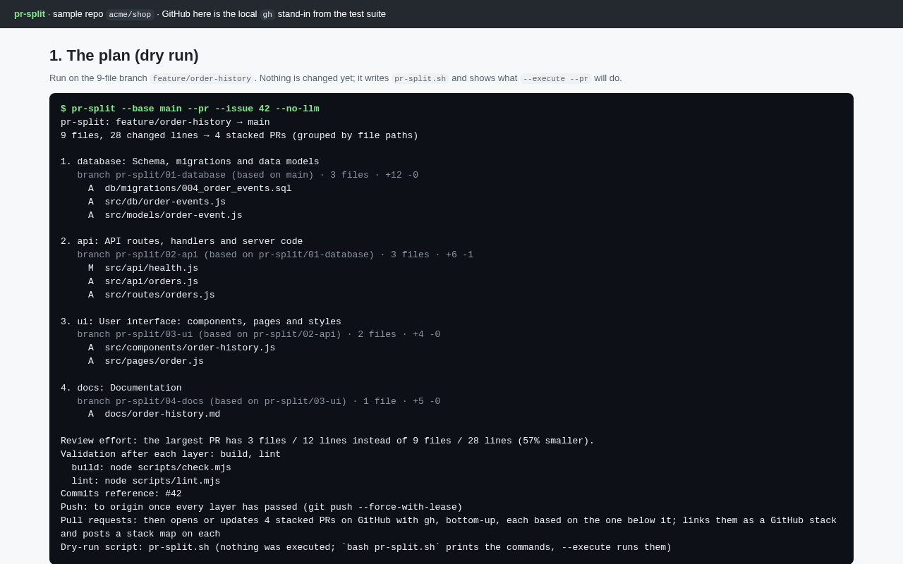
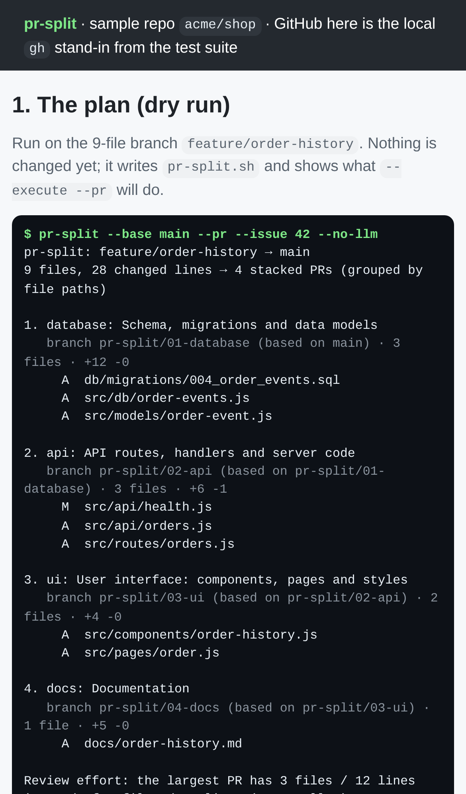

# PR Splitter AI — Automated pull request splitting into reviewable stacks

## Screenshots


A dry run of `pr-split --pr` on a sample shop's 9-file branch: four layers with their files, the validation commands, the push and the PR step. Nothing has been changed yet.


The end of `pr-split --execute --pr`: every layer passed `build` and `lint` before anything was pushed. Then 4 PRs were opened bottom-up, linked as a native GitHub stack, and each got a stack map.


PR #129 as pr-split opened it. On the left, the description: a summary of its group's files, "Depends on #128", and the exact commit that passed validation. On the right, the stack-map comment with "this PR" marked. GitHub is played by the local `gh` stand-in from the test suite, because the sandbox has no network.


The same plan on a phone (iPhone 13 viewport).


The end of the `--execute --pr` run on a phone: the four PR URLs and the stack link.


PR #129's description on a phone.

`npm run screenshots` regenerates these from a real run (needs `CHROMIUM_PATH`).

For developers overwhelmed by large PRs, AI analyzes changes and creates stacked, reviewable pull requests with dependency-aware splits.

- [Research](RESEARCH.md) — findings and sources
- [PRD](PRD.md)
- [Roadmap](ROADMAP.md)
- [Build notes](BUILD.md): what works today, how to run it, test status

```bash
npm install && npm test
node bin/pr-split.js --base main              # inside the repo you want to split; writes a dry-run pr-split.sh
node bin/pr-split.js --base main --execute    # builds the stacked branches, validating each layer
node bin/pr-split.js --base main --execute --pr --issue 123   # …then pushes them and opens one PR per layer (needs gh)
node bin/pr-split.js --base main --pr-only    # opens or updates the PRs for a stack built earlier
```

Effort: Medium · Confidence: Medium

_Researched by the idea pipeline on 2026-10-10 ([original record](https://github.com/smithdavedesign/idea-factory/tree/main/ideas/pr-split)); repo created on David's go-ahead 2026-10-11._
