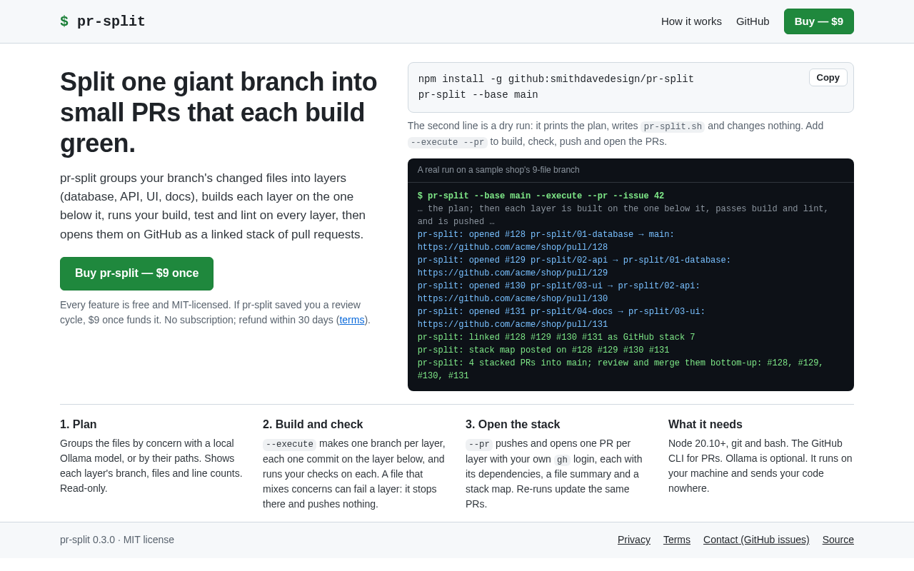
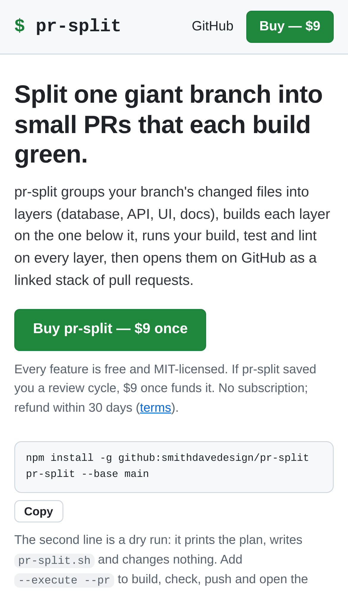
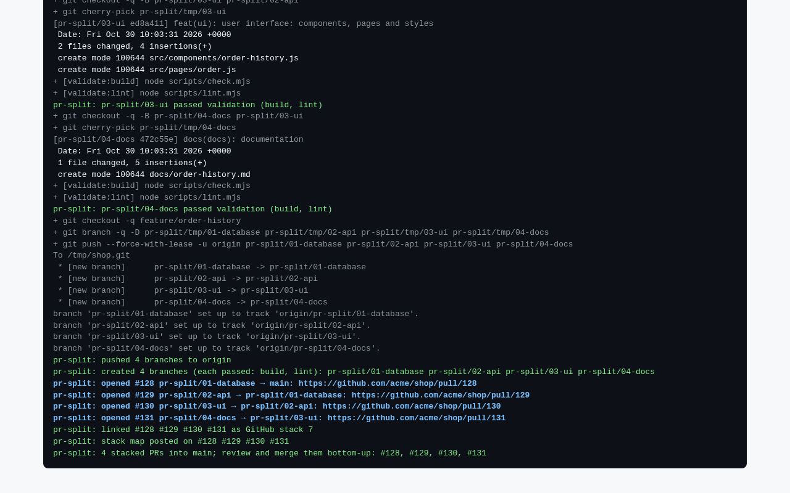
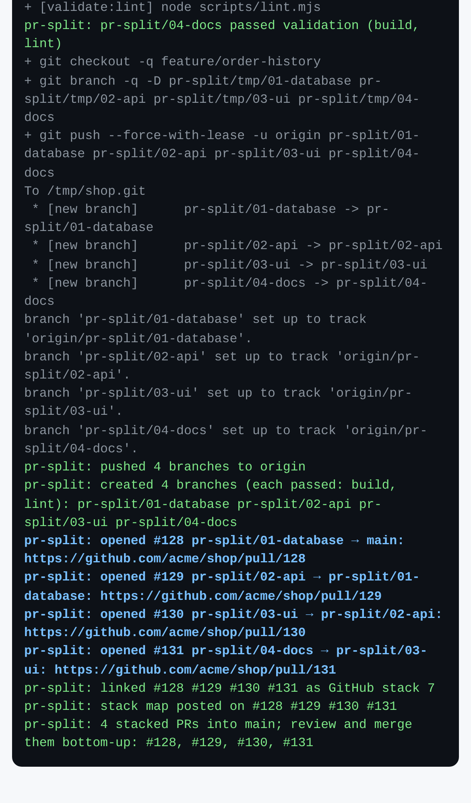
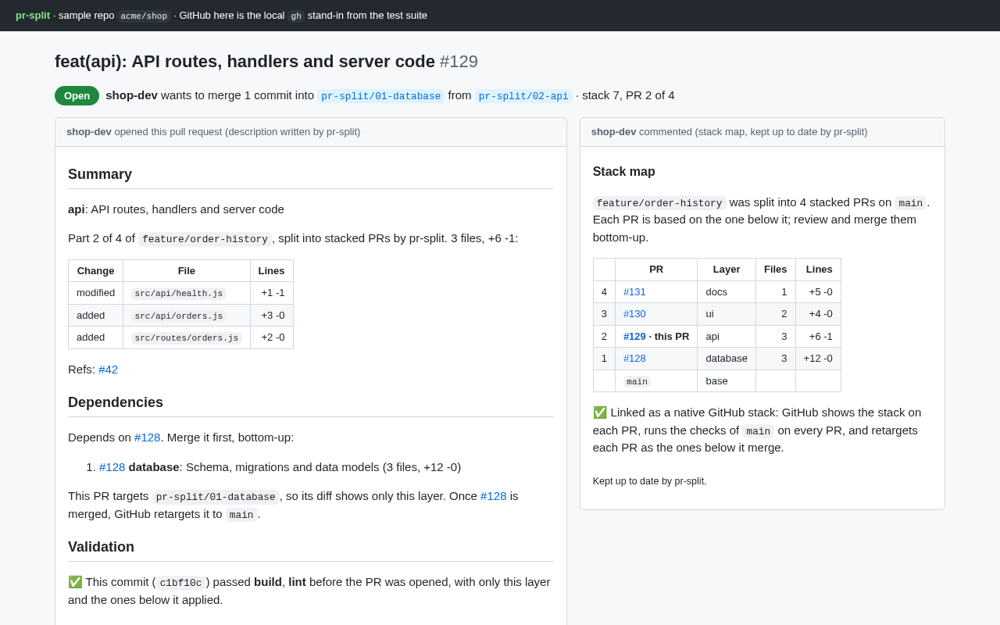
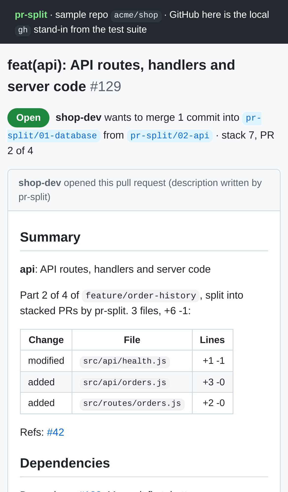

# PR Splitter AI — Automated pull request splitting into reviewable stacks

## Screenshots


The launch-ready landing page from the production build: the Buy button (placeholder payment link), the install command with its Copy button, a real run, and the footer links to Privacy and Terms.


The same page on a phone (iPhone 13 viewport): it fits the screen, and Buy is in the header and under the pitch.


The core action, run for real on a sample shop's 9-file branch: every layer passed `build` and `lint` before anything was pushed. Then 4 PRs were opened bottom-up, linked as a native GitHub stack, and each got a stack map.


The end of the same `--execute --pr` run on a phone: the four PR URLs and the stack link.


The result: PR #129 as pr-split opened it, with its files, "Depends on #128", the commit that passed validation, and the stack-map comment. GitHub is played by the local `gh` stand-in from the test suite, because the sandbox has no network.


PR #129's description on a phone.

`npm run screenshots` regenerates these from a real run and the site's production build (needs `CHROMIUM_PATH`).

For developers overwhelmed by large PRs, AI analyzes changes and creates stacked, reviewable pull requests with dependency-aware splits.

- [Research](RESEARCH.md) — findings and sources
- [PRD](PRD.md)
- [Roadmap](ROADMAP.md)
- [Build notes](BUILD.md): what works today, how to run it, test status
- [Launch readiness](LAUNCH-READY.md): the website, privacy and terms pages, the Buy button, the visit beacon, and what's left before launch

```bash
npm install && npm test
node bin/pr-split.js --base main              # inside the repo you want to split; writes a dry-run pr-split.sh
node bin/pr-split.js --base main --execute    # builds the stacked branches, validating each layer
node bin/pr-split.js --base main --execute --pr --issue 123   # …then pushes them and opens one PR per layer (needs gh)
node bin/pr-split.js --base main --pr-only    # opens or updates the PRs for a stack built earlier
npm run build                                 # the website (site/) into dist/, as Vercel builds it
```

Effort: Medium · Confidence: Medium

_Researched by the idea pipeline on 2026-10-10 ([original record](https://github.com/smithdavedesign/idea-factory/tree/main/ideas/pr-split)); repo created on David's go-ahead 2026-10-11._
